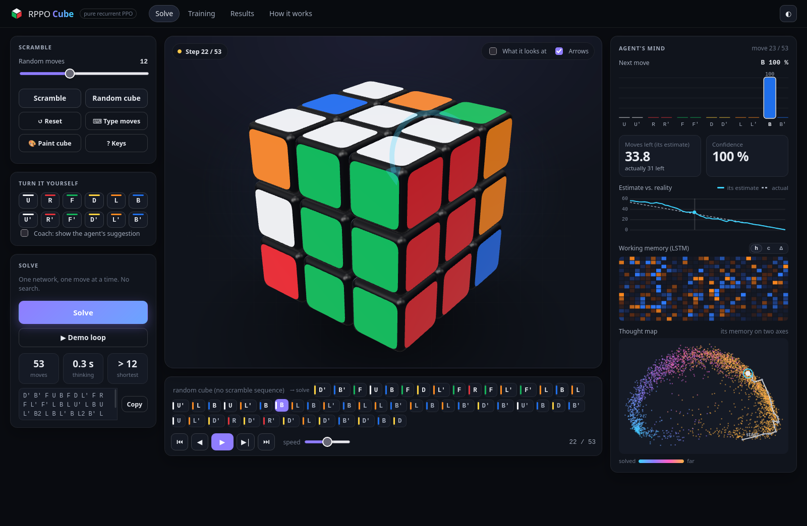

# RPPO Cube: a pure recurrent PPO agent that solves the Rubik's cube

One neural network with a memory (LSTM, 8.9 million weights) turns the faces of a 3x3x3 cube until it is solved.
It learned by trial and error alone, with recurrent PPO and a single reward: −1 for every move. Nobody showed it
a solution, and it does not search: it looks at the cube and picks the next turn.



| Test cubes, never seen in training | solved | mean moves |
|---|---|---|
| 1,000 random cubes | 1,000 | 56.4 |
| The 1,000 test cubes of the DeepCubeA paper | 1,000 | 56.6 |

The best published systems need about 21 moves on that test set, with a search on top of their network.
This agent needs 57, with no search. All numbers come from one training run.

## Run it

```bash
pip install torch                  # the build for your machine: see pytorch.org
pip install -r requirements.txt
python -m rubik.web                # then open http://127.0.0.1:5000
```

No GPU is needed to run it: a solve takes about one second on a CPU.

- **Solve:** scramble the cube, or paint your own, and watch the agent solve it, with a look into its mind.
- **Training:** how it learned, and the agent as it was at seven moments of its training.
- **Results:** the numbers on test cubes.
- **How it works:** the idea on one page.

## What is where

| Path | What |
|---|---|
| `agent/` | The trained agent: the network (`policy.pt`), its training log, seven snapshots and its test results. |
| `rubik/cube.py` | The cube: moves, scrambles, validation, the network's input. |
| `rubik/env.py` | The training environment: −1 per move, move limits, easy cubes first. |
| `rubik/policy.py` | The network. |
| `rubik/ppo.py`, `rubik/train.py` | Recurrent PPO. |
| `rubik/agent.py` | Solving one cube, with a record of every step. |
| `rubik/benchmark.py` | The numbers of the Results view. |
| `rubik/optimal.py`, `rubik/deepcubea.py` | Shortest solutions for shallow cubes, and the papers' test set. |
| `rubik/web/` | The web app. |

## Train your own

Training needs a GPU. The agent here practised 1.38 billion moves, 16,384 cubes at a time, in two stages:

```bash
# Stage 1: a tight move limit per cube. It ends with 44 % of random cubes solved.
python -m rubik.train --out my_agent --total-samples 7.5e8

# Stage 2: up to 200 moves for deep scrambles. It ends with 100 % (stopped by hand after 1.38 billion moves).
python -m rubik.train --out my_agent --total-samples 1.9e9 \
    --lr 2e-4 --ent-coef 0.0044 --cur-explore 0.4 --limit-slope 20 --limit-knee 10 --limit-cap 200

python -m rubik.web --agent my_agent                         # watch it
python -m rubik.benchmark --agent my_agent --curve --papers  # measure it
```

The same training command resumes after a stop. From Python:

```python
from rubik import cube as C
from rubik.agent import Agent

agent = Agent("agent/policy.pt", "cpu")
cube = C.apply_moves(C.solved_state(), C.parse_moves("R U F' L2 D B'"))
print(agent.trace(cube, attention=False)["notation"])
```
